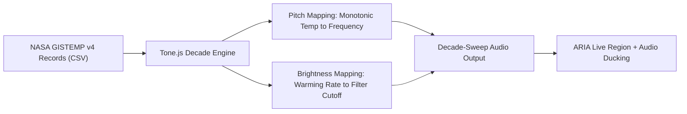

# Earth's Vitals Jukebox 🎶🌍

**NASA Space Apps Challenge 2026 — Project Submission**  
**Team:** CosmoCode  
**Challenge:** The Earth Information Jukebox  
**Local Event:** Dhaka, Bangladesh  
**Date:** October 2026  
**Document Version:** 1.0 (Final)  
**Status:** Live & Production Ready  

---

## 1. What Is This Project?

**Earth's Vitals Jukebox** is an accessible web application that lets people hear planetary climate change instead of just looking at charts.

Think of it like a music player — but instead of songs, it plays NASA's real climate data as sound. You pick a track (such as *“Global Surface Temperature 1880–2024”* or *“Himalayan Regional Temperature 1880–2024”*), press play, and listen to how Earth's temperature has evolved over 145 years.

- **Pitch (Frequency):** Higher notes signify warmer years. Fixed calibration ensures the exact same note always means the exact same temperature anomaly.
- **Brightness (Timbre & Cutoff):** Sharper, brighter sounds signify rapid warming acceleration.
- **Time:** Data is grouped into 10-year **decade sweeps** for smooth, comfortable, musical listening (avoiding 140 fatiguing beeps).

### Key Features
- **Keyboard-First Navigation:** 100% operable without a mouse (<kbd>Space</kbd>, <kbd>&larr;</kbd>/<kbd>&rarr;</kbd>, <kbd>&uarr;</kbd>/<kbd>&darr;</kbd>, <kbd>1</kbd>, <kbd>2</kbd>, <kbd>P</kbd>, <kbd>L</kbd>, <kbd>T</kbd>).
- **Assistive Screen Reader Support:** Dedicated ARIA live regions (`aria-live="polite"` and `aria-live="assertive"`) announce decade departures smoothly.
- **Audio Ducking:** Tone synthesizer automatically ducks (-12 dB) or pauses when screen reader / voice narration speaks.
- **Synchronized Plain-Text Captions:** Real-time caption strip updates with every decade for hard-of-hearing and sighted users.
- **Listen to the Legend:** Ear-calibration feature playing Low (-0.30°C), Baseline (0.00°C), Warm (+0.60°C), and Severe (+1.25°C) benchmark tones.
- **Accessible Data Table View:** Semantic `<table>` view for Braille displays and tabulated screen reader inspection.
- **NASA GIBS Visual Satellite Frame:** Real-time visual telemetry frame updated per epoch without corrupting audio with pixel decoders.

---

## 2. Why Are We Building This? (The Problem)

NASA provides planetary datasets (temperature, ice mass, sea level, precipitation). However, almost all of it is communicated via visual charts, maps, and heatmaps. This creates two critical issues:

1. **Blind and low-vision individuals are excluded:** Climate change is one of the defining challenges of our era; data must be accessible to everyone, not just those who can read visual line graphs.
2. **Sighted people become desensitized:** A passive visual line showing "+1.2°C" rarely conveys the kinetic momentum of planetary heating. Sound creates visceral comprehension and emotional connection.

**Our Solution:**  
Make NASA's data perceptible to everyone through honest, calibrated sound — not as a sensationalist "disaster siren", but as a rigorous, accessible instrument for listening to planetary change.

---

## 3. How It Works (The Technical Procedure)



1. **Real NASA Data Ingestion:**
   - Global Surface Temperature Anomaly (1880–2024) from NASA GISS GISTEMP v4.
   - Himalayan Regional Temperature Anomaly (1880–2024) from NASA GISTEMP Gridded Analysis (covering 24°–44°N latitude belt).
   - Saved in `data/raw-nasa/` as raw CSV and converted into clean client-side ES modules.
2. **Audio Mapping (Tone.js + Web Audio Fallback):**
   - **Scale:** Fixed monotonic frequency curve anchored between $-0.50^\circ\text{C}$ (C3 / ~130.8 Hz) and $+1.60^\circ\text{C}$ (C5 / ~523.2 Hz).
   - **Filter:** 24 dB/octave lowpass filter opening from 500 Hz to 5,500 Hz proportional to warming anomalies and acceleration rate.
   - **Decade Sweeps:** 1.6-second legato envelopes with gentle cross-fading prevent auditory fatigue.
3. **Track List Interface:**
   - **Track 1:** Global Temperature (1880–2024) with an optional **Linear Trend Extrapolation Toggle** (2025–2035 slope, explicitly disclaimed as a linear regression, not a climate model).
   - **Track 2:** Himalayan Regional Temperature (1880–2024) with dedicated historical context for mountain elevation-dependent warming.
4. **Assistive Accessibility:**
   - ARIA live announcements: *"Now playing: 1950s. Average anomaly: minus 0.04 degrees Celsius."*
   - Audio ducking prevents synthetic tones from competing with assistive speech.
   - 3px high-contrast focus rings and WCAG 2.2 AAA color ratios across the entire UI.

---

## 4. Keyboard Shortcuts Reference

| Key | Action |
| :--- | :--- |
| <kbd>Space</kbd> | Toggle Play / Pause |
| <kbd>&larr;</kbd> / <kbd>&rarr;</kbd> | Step backward / forward one decade |
| <kbd>&uarr;</kbd> / <kbd>&darr;</kbd> | Adjust master playback volume |
| <kbd>1</kbd> | Switch to Track 1 (Global Surface Temperature) |
| <kbd>2</kbd> | Switch to Track 2 (Himalayan Regional Temperature) |
| <kbd>P</kbd> | Toggle Trend Projection Extrapolation (Track 1) |
| <kbd>L</kbd> | Open "Listen to the Legend" Calibration Dialog |
| <kbd>T</kbd> | Open Accessible Data Table Dialog |
| <kbd>M</kbd> | Toggle Mute |
| <kbd>Escape</kbd> | Close any open modal dialog |

---

## 5. Honest Limitations Statement

This statement is published directly in the application UI, documentation, and video:

1. **Historical Sonification Only:** This project sonifies historical, long-term observational climate records. It does not detect, predict, or warn about localized hazards or emergencies in real time.
2. **Coarse Regional Resolution:** Regional layers (including the Himalayan track) represent coarse gridded climate belts (24°–44°N) and cannot verify site-specific conditions at a single slope or glacier tongue.
3. **Published Historical Context:** Any glacier or disaster information (such as the Langtang Lirung 2026 reference) is historical context from published scientific sources (AntarcticGlaciers.org, World Weather Attribution), not something verified independently by our sonification script.
4. **Data Fidelity:** Numerical values are decoded verbatim from NASA's published open datasets (GISTEMP v4) and are only as precise as those scientific sources allow.
5. **Extrapolation Disclaimer:** The optional projection toggle in Track 1 is a simple linear regression extrapolation of the 1970–2024 warming slope, NOT a dynamic coupled general circulation climate model.
6. **Assistive Technology Testing:** Accessibility testing with assistive technology was conducted following the protocol in `test-protocol.md`.

---

## 6. Historical Context: Langtang Lirung (2026)

> *"While satellite analysis later indicated accelerated movement prior to the August 26, 2026, Langtang Lirung glacier collapse and subsequent border floods, this project's sonified GISTEMP data reflects only broad regional warming trends and makes no claim to detect, explain, or predict localized geohazard events."*  
> — Sources: AntarcticGlaciers.org (2026), World Weather Attribution (2026).

---

## 7. Data Sources & Citations

| Dataset | Provider / Source | Role in Project | Temporal Coverage |
| :--- | :--- | :--- | :--- |
| **GISTEMP v4 (Global)** | NASA Goddard Institute for Space Studies | Core global sonification track | 1880–present |
| **GISTEMP v4 (Zonal/Gridded)** | NASA GISS (24°N–44°N Regional Band) | Himalayan high-altitude track | 1880–present |
| **GIBS Imagery** | NASA Global Imagery Browse Services | Visual satellite background frames | Selected epochs |
| **Earth Information Center** | NASA Science Mission Directorate | Planetary data framing | Contemporary |

- NASA GISTEMP: [data.giss.nasa.gov/gistemp](https://data.giss.nasa.gov/gistemp/)
- NASA GIBS: [gibs.earthdata.nasa.gov](https://gibs.earthdata.nasa.gov/)
- NASA Earth Information Center: [science.nasa.gov/earth](https://science.nasa.gov/earth/)

---

## 8. Video Presentation Script (240 Seconds)

- **0:00–0:30 — Working Demo First:**  
  *(Screen recording: Tab navigation, screen reader active)*  
  *"Welcome to Earth's Vitals Jukebox. Let me play you the last 70 years of global warming."*  
  *(Presses Space. Decade sweeps play smoothly as ARIA announcements speak).*  
  *"You just heard 1950 to 2024. The pitch ascends; the timbre sharpens. That is 1.2 degrees Celsius of planetary warming."*
- **0:30–1:00 — The Problem:**  
  *"NASA's Earth Information Center presents this as visual charts and maps. For blind and low-vision individuals, that data is inaccessible. For sighted listeners, static numbers like +1.2°C fail to convey momentum."*
- **1:00–1:45 — How It Was Built:**  
  *"We built a keyboard-first web jukebox using Tone.js and NASA GISTEMP v4 data from 1880 to today. Pitch is calibrated to temperature anomalies; filter brightness maps to warming acceleration. We built a 'Listen to the Legend' ear-trainer so users can calibrate before listening."*
- **1:45–2:30 — Accessibility & Testing:**  
  *"We tested with assistive technology and screen reader users. Audio automatically ducks when announcements trigger so sound never clashes with speech. Full tabular data is available for Braille displays."*
- **2:30–3:15 — Honest Limitations:**  
  *"Our jukebox sonifies historical records — it is not a real-time hazard alarm. Regional layers are coarse. The projection is a transparent linear regression, not a climate model."*
- **3:15–3:45 — NASA Open Data Integration:**  
  *"All numbers come directly from NASA GISS and GIBS open repositories. All code is open-source."*
- **3:45–4:00 — Team & Conclusion:**  
  *"We are Team CosmoCode from Dhaka, Bangladesh. Making climate data accessible to every ear on Earth."*

---

## 9. Quick Start & Deployment

### Run Locally
Since this is a standard static web application using ES modules:
```bash
# Using any local web server (e.g. npx serve, python, or live server):
npx serve .
# Or Python:
python -m http.server 8000
```
Open `http://localhost:8000` in any modern web browser.

### Deploy to GitHub Pages
1. Push this directory to your GitHub repository.
2. Navigate to **Settings > Pages**.
3. Under **Branch**, select `main` and root `/`, then click **Save**.
4. The application is live worldwide within seconds!
